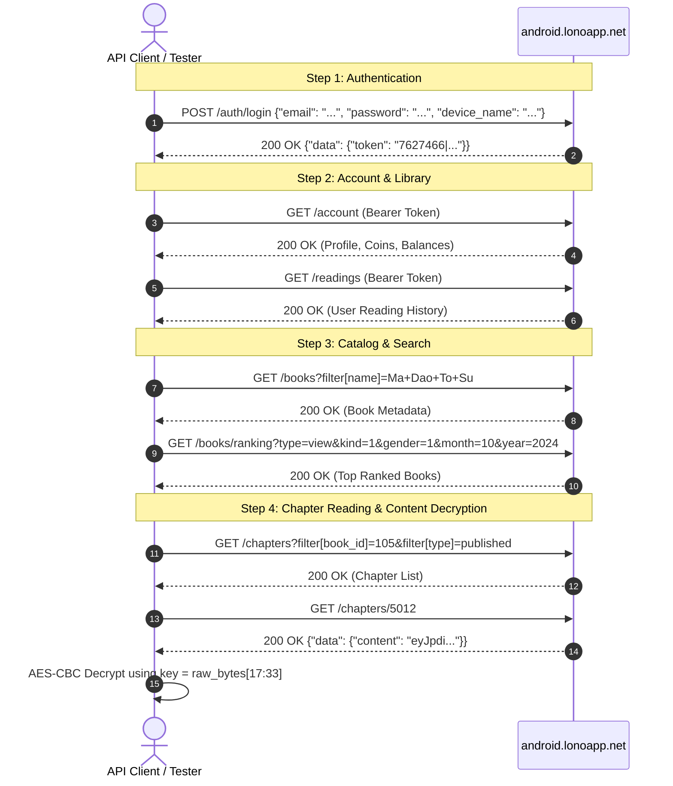

# MTC.apk (NovelFever) API & System Architecture Specification

> **Verified Technical Documentation** for **MTC.apk** (`com.novelfever.app.android`).  
> Reconciles static REA disassembly with live backend validation against `https://android.lonoapp.net/api`.

---

## 1. Verified Architecture & Server Environment

* **Target Application**: MTC / NovelFever (`com.novelfever.app.android`), version `1.4.1` (build `357`).
* **Active Backend Gateway**: `https://android.lonoapp.net/api`
* **Backend Architecture**: Laravel (Laravel Sanctum personal access tokens `ID|plainTextToken`).
* **Client Architecture**: Flutter / Dart AOT with local Floor SQLite cache, native media services (`AudioService`), and a native chapter downloader (`DownloadAllActivity`).

---

## 2. Authentication & Session Protocol

### 2.1 User Login (`POST /auth/login`)
The backend is a Laravel Sanctum service requiring `email`, `password`, and `device_name`.

* **Endpoint**: `POST https://android.lonoapp.net/api/auth/login`
* **Headers**:
  ```http
  Content-Type: application/json
  Accept: application/json
  ```
* **Request Payload**:
  ```json
  {
    "email": "user@example.com",
    "password": "user_password",
    "device_name": "Pixel 7"
  }
  ```
  *(Note: Omitting `email` returns `422 Unprocessable Entity`: "Trường email không được bỏ trống". Omitting `device_name` causes token issuance failure).*
* **Response (HTTP 200)**:
  ```json
  {
    "status": 200,
    "success": true,
    "data": {
      "token": "7627466|abcdef1234567890..."
    }
  }
  ```

### 2.2 Authenticated Requests
All subsequent protected calls require the Sanctum Bearer token:
```http
Authorization: Bearer 7627466|abcdef1234567890...
```

---

## 3. Verified Live Endpoints Catalog

| Domain / Resource | Endpoint | Method | Key Parameters / Payload | Notes |
| :--- | :--- | :--- | :--- | :--- |
| **User Profile & Balance** | `/account` | `GET` | *(Requires Bearer Token)* | Returns user info, reading stats, and coin/candy/key balances. Replaces client-side UI aliases `/users/profile` and `/balance`. |
| **Account Settings** | `/account/setting` | `GET`, `POST` | Preference JSON | Reading typography, theme, notifications, and auto-unlock flags. Replaces `/user_settings`. |
| **Transaction Ledger** | `/account/transactions` | `GET` | `?wallet=default&page=1` | Financial transaction history. Supported wallet types: `default`, `candy`, `bonus`. |
| **Active Devices** | `/account/devices` | `GET` | None | Lists logged-in devices and sessions. |
| **Novel Catalog** | `/books` | `GET` | `?include=author,creator,genres`<br>`&filter[state]=published`<br>`&page=1&limit=20` | Returns paginated list of novels adhering to JSON:API standard. |
| **Title Search** | `/books` | `GET` | `?filter[name]=<query>` | Performs substring novel title search. (Replaces standalone `/search` UI route). |
| **Leaderboards / Ranking** | `/books/ranking` | `GET` | `?type=view&kind=1&gender=1&month=10&year=2024` | Requires explicit classification, gender, month, and year query parameters. |
| **Book Options** | `/books/options` | `GET` | `?book_id=<id>` | Retrieves reader and layout rules for a specific novel. |
| **Book Suggestions** | `/books/suggests` | `GET` | `?user_id=<user_id>&book_id=<book_id>` | Recommendations related to the current novel and user history. |
| **Novel Fans / Patrons** | `/books/fans` | `GET` | `?filter[book_id]=<id>` | Top patron/supporter leaderboard for a specific book. |
| **Chapter Listing** | `/chapters` | `GET` | `?filter[book_id]=<id>&filter[type]=published&limit=100&page=1` | Index of chapters, lock statuses, and pricing. |
| **Chapter Content** | `/chapters/{id}` | `GET` | Path variable `{id}` | Returns chapter content, title, and pagination (`nextId`, `previousId`). Replaces `/chapter_detail`. |
| **Reading Sync** | `/readings` | `GET`, `POST` | `{"book_id": 105, "chapter_id": 5012, "chapter_index": 1}` | Cloud synchronization of current reading bookmarks. |
| **Bookmarks** | `/bookmarks` | `GET`, `POST` | `{"book_id": 105, "chapter_id": 5012}` | Save/remove story bookmarks. |
| **Comments** | `/comments` | `GET`, `POST` | `?filter[object_id]=<id>&filter[object_type]=chapter` | Chapter discussion threads. |
| **Reviews** | `/reviews` | `GET`, `POST` | `average_score: "5.0"`, `content: "..."` (must be > 100 words) | Book reviews. Strict server-side content length validation. |
| **Gifts** | `/gifts` | `GET` | `?filter[book_id]=<id>` | Available gifts and donation records. |
| **Support Tickets** | `/tickets` | `GET`, `POST` | None | User feedback and support inquiries. |
| **Mystery Boxes** | `/topboxes` | `GET`, `POST` | None | Reward and lootbox distributions. |
| **Notifications** | `/notifications` | `GET` | None | System announcements and novel update notifications. |

---

## 4. Chapter Content Encryption & Decryption Engine

When chapters are delivered encrypted, the payload is structured in a standard Laravel cryptographic envelope:

```json
{
  "data": {
    "content": "eyJpdiI6Imsy..."
  }
}
```

### Decryption Implementation
Decompiled directly from `com.example.novelfeverx.DownloadAllActivity.4.decryptContent`:

1. **Envelope Structure**: Decoding the Base64 string yields:
   ```json
   {
     "iv": "<BASE64_IV>",
     "value": "<BASE64_CIPHERTEXT>",
     "mac": "<HMAC_SHA256>"
   }
   ```
2. **Algorithm**: `AES/CBC/PKCS5Padding`.
3. **Key Derivation**: 16 bytes extracted from offset 17 to 33 of the raw ASCII string (`bytes[17:33]`).
4. **IV**: 16 bytes decoded from `iv`.
5. **Decryption Execution (Python Reference)**:
   ```python
   import base64
   import json
   from Crypto.Cipher import AES
   from Crypto.Util.Padding import unpad

   def decrypt_chapter(content_str: str) -> str:
       raw_bytes = content_str.encode('ascii')
       decoded_envelope = json.loads(base64.b64decode(raw_bytes))
       
       iv = base64.b64decode(decoded_envelope['iv'])
       ciphertext = base64.b64decode(decoded_envelope['value'])
       key = raw_bytes[17:33]
       
       cipher = AES.new(key, AES.MODE_CBC, iv)
       decrypted_bytes = unpad(cipher.decrypt(ciphertext), AES.block_size)
       return decrypted_bytes.decode('utf-8')
   ```

---

## 5. Decommissioned / Dead Code Features in APK

Static disassembly of `MTC.apk` reveals several legacy or unrouted strings that do not correspond to active routes on `https://android.lonoapp.net/api`:

* **`chat.truyen.onl`**: Domain is offline / unresolvable via DNS. Real-time chat features are inactive.
* **Missions & Tasks (`/missions`, `/tasks`, `/claim/check`)**: Return `404 Not Found` on the live gateway.
* **Ballots & Promo Codes (`/ballot`, `/auth/ballot`, `/redeem`, `/auth/redeem`)**: Return `404 Not Found`.
* **In-App Purchase Endpoint (`/iap`)**: Not active on the primary gateway.
* **Flutter Internal Navigation Routes**:
  * Paths like `/chapter_detail`, `/users/profile`, `/user_settings`, `/balance`, `/search` were internal Flutter navigation strings (`Navigator.pushNamed`), which map to the distinct REST APIs documented in Section 3 (`/chapters/{id}`, `/account`, `/account/setting`, `/books?filter[name]=...`).

---

## 6. Client Database Schema (Floor SQLite)

Offline chapters and reading states are stored in the device's SQLite database via Floor:

```sql
CREATE TABLE IF NOT EXISTS `BaseBook` (
    `id` INTEGER PRIMARY KEY,
    `name` TEXT,
    `slug` TEXT,
    `synopsis` TEXT,
    `jsonGenres` TEXT,
    `jsonPoster` TEXT,
    `authorId` INTEGER,
    `userId` INTEGER,
    `voteCount` INTEGER,
    `authorName` TEXT,
    `userName` TEXT,
    `reviewScore` TEXT,
    `reading` INTEGER,
    `following` INTEGER,
    `getNotification` INTEGER,
    `lastReadingTime` INTEGER,
    `currentChapterId` INTEGER,
    `autoUnlock` INTEGER,
    `bookmarkId` INTEGER,
    `latestIndex` INTEGER,
    `currentChapterIndex` INTEGER,
    `bookmarkedChapterIndex` INTEGER,
    `published` INTEGER
);

CREATE TABLE IF NOT EXISTS `Chapter` (
    `id` INTEGER PRIMARY KEY,
    `name` TEXT,
    `slug` TEXT,
    `index` INTEGER,
    `editor` TEXT,
    `content` TEXT,
    `nextId` INTEGER,
    `previousId` INTEGER,
    `likeCount` INTEGER,
    `translator` TEXT,
    `publishedAt` TEXT,
    `commentCount` INTEGER,
    `bookId` INTEGER,
    `react` INTEGER,
    `lockType` INTEGER,
    `unlockPrice` INTEGER,
    `log` TEXT
);
```

---

## 7. Working API Interaction Workflow


